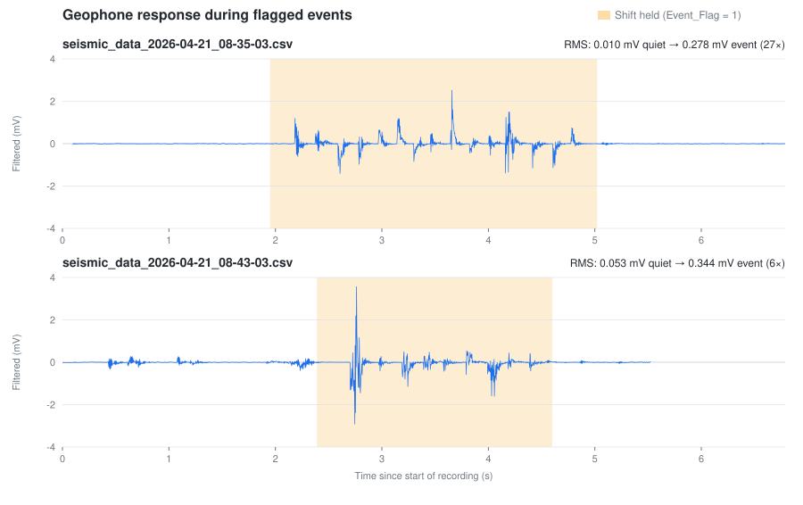

# Geophone Seismic Detector

A small experiment to find out whether a **consumer-grade geophone** can detect ground vibrations such as **footsteps within ~100 ft**.

A geophone's millivolt-level output is digitized with a 16-bit ADC, band-pass filtered on the microcontroller, streamed to a PC, logged to CSV, and turned into features for event detection / ML.

## Results so far



Each trace is the on-device band-passed signal. The shaded region is where the operator held **Shift** while the event happened (`Event_Flag = 1`). In both recordings the signal inside the window is clearly larger than the surrounding quiet:

| Recording | Quiet RMS | Event RMS | Ratio |
|---|---|---|---|
| `2026-04-21_08-35-03` | 0.010 mV | 0.278 mV | ~27× |
| `2026-04-21_08-43-03` | 0.053 mV | 0.344 mV | ~6× |

**Status: preliminary.** The geophone responds well above the noise floor to flagged events, but the logs don't record stimulus type or distance, so the **100 ft detection range is not yet established**. The second recording also has a noisier baseline before the event, which shows that false triggers are a real concern. Next steps are logging a distance for each trial and evaluating the engineered features (below) as detectors.

## Hardware

- Geophone wired to the differential inputs **A0/A1** of an **ADS1115** 16-bit ADC (gain 16, ±0.256 V, 860 SPS)
- **Adafruit Feather ESP32-S3** (no PSRAM) reading the ADC over I²C
- USB serial link to a PC (115200 baud)

## How it works

| Stage | File | What it does |
|---|---|---|
| Firmware | [`src/main.cpp`](src/main.cpp) | Samples the ADC, applies a one-pole high-pass + low-pass filter (roughly a 7–24 Hz band, per the comments in the code), prints `Raw`, `Voltage`, `Filtered` over serial |
| Logger | [`src/geophone_logger.py`](src/geophone_logger.py) | Reads serial, timestamps each sample (UTC), writes a CSV. Holding **Shift** sets `Event_Flag = 1` so you can label events live |
| Features | [`src/feature_engineering.py`](src/feature_engineering.py) | Rolling variance, energy, zero-crossing rate, STA/LTA and peak amplitude for ML |
| Plot | [`src/plot_results.py`](src/plot_results.py) | Regenerates the figure above |

CSV columns: `UTC_Timestamp, Raw_Value, Voltage, Filtered, Event_Flag`.

## Usage

Requires Python ≥ 3.11 (dependencies in `pyproject.toml`, managed with [uv](https://docs.astral.sh/uv/)) and [PlatformIO](https://platformio.org/).

```bash
# 1. Flash the firmware
pio run -t upload

# 2. Log data (set SERIAL_PORT in the script first; it defaults to COM4)
uv run src/geophone_logger.py

# 3. Build features from a log (edit input_file at the bottom of the script)
uv run src/feature_engineering.py

# 4. Re-render the figure from one or more logs
uv run src/plot_results.py src/seismic_data_<timestamp>.csv -o docs/results.svg
```

Log CSVs are git-ignored, so the committed figure is the record of the results shown here. Note that the logger can occasionally write a garbled line when a serial read is split mid-line. `plot_results.py` drops those rows.
